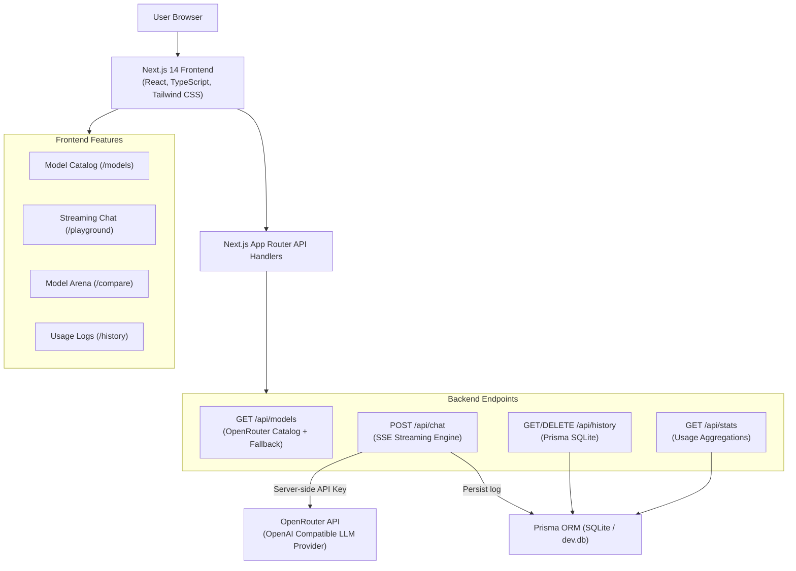

# ⚡ AI Model Playground & Benchmark Arena

A modern, full-stack web application designed for exploring, benchmarking, and testing state-of-the-art AI models (DeepSeek R1, Llama 3.3, Claude 3.5 Sonnet, GPT-4o, Gemini 2.0 Flash, Qwen 2.5 Coder, Mistral Large 2, etc.) with real-time token streaming, side-by-side model comparison, and full usage analytics persisted in SQLite via Prisma ORM.

---

## 🌟 Key Features

### 1. 🔍 Model Discovery & Catalog (`/` and `/models`)
- **Extensive Model Directory:** Real-time catalog synced with OpenRouter public API + curated benchmark datasets.
- **Search & Advanced Filters:** Filter by provider (*OpenAI, Anthropic, Google, Meta, DeepSeek, Mistral, Alibaba*) and capabilities (*Chat, Code, Reasoning, Vision, Math, Free*).
- **Technical Specifications:** Context window size (up to 1M+ tokens), output limits, speed ratings, and cost per 1M prompt/completion tokens.
- **Instant Playground Launch:** 1-click **"Try in Playground"** button pre-loads any selected model.
- **Detailed Model Drawer:** Inspect model architectures, training milestones, and recommended prompts.

### 2. ⚡ AI Playground (`/playground`)
- **Real-Time Streaming Responses:** Smooth Server-Sent Events (SSE) streaming with live markdown rendering and syntax-highlighted code blocks.
- **Model Switcher:** Seamlessly switch between models without losing context.
- **Tunable Hyperparameters:** Adjust System Prompt, Temperature (0 to 1.5), Max Output Tokens, and Top-P nucleus sampling.
- **Performance Metrics:** Real-time latency measurement (in milliseconds), token estimation, and output speed tracking.
- **Sample Benchmark Prompts:** 1-click presets for coding tasks, logic riddles, system design, and database trade-offs.
- **Bring Your Own Key (BYOK) + Demo Simulation:** Enter your OpenRouter API key in Settings, use a server-configured key in `.env`, or test out the intelligent interactive demo simulation mode immediately out-of-the-box.

### 3. ⚖️ Side-by-Side Model Arena (`/compare`)
- **Concurrent Benchmarking:** Send a single prompt simultaneously to two different models (e.g., *DeepSeek R1* vs. *Llama 3.3 70B*).
- **Latency & Speed Race:** Live badges identifying the faster model and comparative token generation throughput.
- **Comparative Output Evaluation:** Evaluate reasoning steps, code style, and factual depth side-by-side.

### 4. 📜 Usage History & Analytics (`/history`)
- **Database Persistence:** Every request, response, latency (ms), and token count is stored in SQLite via Prisma ORM.
- **Analytics Overview:** Total prompts, total tokens consumed, average latency, and most used models.
- **Search & Filter:** Search by keywords, filter by status (*Success/Error*), or paginate through records.
- **Replay in Playground:** 1-click to re-load past prompts and models into the playground.
- **Data Export:** Export complete historical logs to JSON for auditing.

---

## 🛠️ Architecture & Tech Stack



- **Frontend:** Next.js 14 (App Router), React 18, TypeScript, Tailwind CSS, Lucide React, React Markdown, Remark GFM.
- **Backend:** Next.js Route Handlers (`/api/chat`, `/api/models`, `/api/history`, `/api/stats`).
- **Database:** Prisma ORM with SQLite (`prisma/dev.db`), easily swappable to PostgreSQL or Supabase.
- **AI Integration:** OpenRouter Unified OpenAI-compatible API (`https://openrouter.ai/api/v1`).
- **Security:** API keys are handled strictly server-side and never exposed to the client.

---

## 🚀 Getting Started

### Prerequisites
- Node.js 18.17+ or 20+ installed
- npm or pnpm installed

### 1. Clone the Repository
```bash
git clone https://github.com/your-username/ai-model-playground.git
cd ai-model-playground
```

### 2. Install Dependencies
```bash
npm install
```

### 3. Configure Environment Variables
Create a `.env` file in the root directory (you can copy `.env.example`):
```env
# Database configuration (SQLite for local file-based persistence)
DATABASE_URL="file:./dev.db"

# OpenRouter AI API Key (Optional default key on server; users can also supply their own key in UI Settings)
OPENROUTER_API_KEY=""

# Application URL
NEXT_PUBLIC_APP_URL="http://localhost:3000"
```

> **Note:** If no `OPENROUTER_API_KEY` is provided, the application runs seamlessly in **Interactive Demo Mode**, allowing you to test streaming UI, token counters, latency benchmarks, and SQLite persistence without having to purchase API credits.

### 4. Initialize Database
Create and sync the SQLite database:
```bash
npx prisma db push
```

### 5. Start the Development Server
```bash
npm run dev
```
Open [http://localhost:3000](http://localhost:3000) in your browser.

---

## 📡 API Reference

### `GET /api/models`
Returns list of AI models with enriched specifications, capabilities, and pricing.
- **Response:** `{ models: AIModel[], source: 'openrouter' | 'curated_cache', count: number }`

### `POST /api/chat`
Streams AI responses using Server-Sent Events (SSE).
- **Body:**
```json
{
  "model": "deepseek/deepseek-r1:free",
  "messages": [{ "role": "user", "content": "Explain quantum computing in simple terms" }],
  "temperature": 0.7,
  "maxTokens": 2048,
  "topP": 1.0,
  "systemPrompt": "You are a helpful expert assistant.",
  "customApiKey": "sk-or-v1-..." // optional BYOK
}
```
- **Stream Chunks:** `data: {"type": "chunk", "text": "..."}`
- **Completion Event:** `data: {"type": "done", "latencyMs": 1420, "tokenUsage": { "prompt": 12, "completion": 240, "total": 252 }}`

### `GET /api/history`
Retrieves paginated usage logs with search and filtering.
- **Query Params:** `?page=1&limit=15&search=keyword&status=success`
- **Response:** `{ logs: UsageRecord[], pagination: { page: 1, limit: 15, total: 42, totalPages: 3 } }`

### `GET /api/stats`
Computes usage statistics and aggregate benchmarks.
- **Response:** `{ totalRequests: 42, totalTokens: 18500, avgLatencyMs: 850, successRate: 100, mostUsedModel: "DeepSeek R1 (Free)" }`

---

## 🔒 Security & Privacy

1. **Server-Side API Key Management:** Keys configured in `.env` are never bundled into client scripts or transmitted to browsers.
2. **BYOK Isolation:** When users input their own key in Settings, it is stored strictly in the client's local storage and sent through HTTPS request headers to authenticate direct API calls.
3. **No Credential Logging:** Request credentials and secret keys are completely stripped and never written to database logs or terminal output.

---

## 🧪 Testing the Application

1. **Explore Catalog:** Navigate to `/` to search and filter models by provider (DeepSeek, Meta, Google, OpenAI, etc.) or capability.
2. **Interactive Playground:** Click **"Try in Playground"** on any model, enter a prompt (or click a Preset Prompt), and click Send to watch the streaming response.
3. **Tweak Parameters:** Click **"Parameters"** in the top-right toolbar to adjust Temperature, Max Output Tokens, and System Prompt.
4. **Compare Models:** Navigate to `/compare`, select two models (e.g. DeepSeek R1 vs Llama 3.3 70B), enter a prompt, and see them race side-by-side.
5. **View History:** Navigate to `/history` to inspect recorded requests, latency in milliseconds, token counts, and export the logs to JSON.

---

## 📄 License
MIT License. Built with ❤️ for AI engineering and model exploration.
